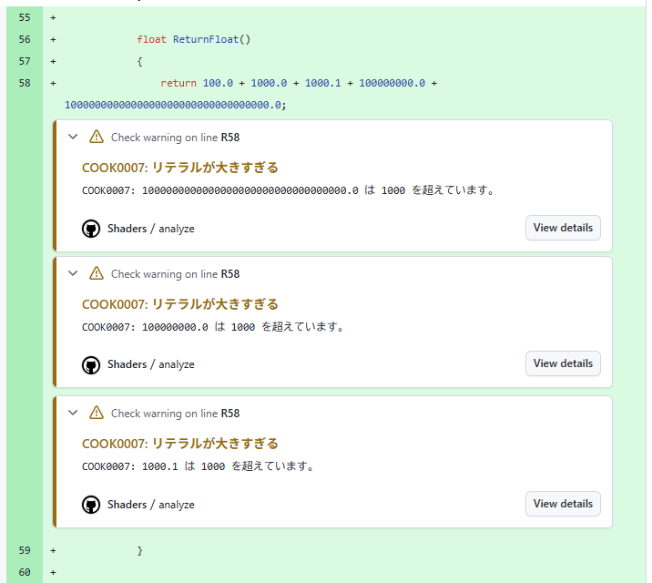

# CI に組み込む

このガイドでは、private リポジトリの Unity プロジェクトを GitHub Actions で解析する方法を説明します。GitHub-hosted runner を使う方法を基本とし、self-hosted runner を使う方法も紹介します。

**どちらの方法も private リポジトリでのみ使用してください。**

- GitHub-hosted runner では、`--unity-generate` で Unity のパッケージヘッダーなどを出力し、リポジトリに含めます。ファイルとライセンス情報をリポジトリへ含めるため、この方法も private リポジトリに限定してください。
- Self-hosted runner では、PR のコードがランナーを置いたマシン上で実行されます。セキュリティ上の理由から、この方法も private リポジトリに限定し、信頼できる投稿者の PR にのみ使用してください。

## 目次

- [CI に組み込む](#ci-に組み込む)
  - [目次](#目次)
  - [1. GitHub-hosted runner で実行する](#1-github-hosted-runner-で実行する)
    - [1-1. Unity のファイルを生成する](#1-1-unity-のファイルを生成する)
    - [1-2. 自作ルールを使わない場合](#1-2-自作ルールを使わない場合)
    - [1-3. 自作ルール入りの CLI を使う場合](#1-3-自作ルール入りの-cli-を使う場合)
  - [2. 自作ルール入り CLI をリリースする](#2-自作ルール入り-cli-をリリースする)
  - [3. セルフホストランナーを用意する](#3-セルフホストランナーを用意する)
    - [3-1. `Library` を作る](#3-1-library-を作る)
    - [3-2. マシンをランナーに登録する](#3-2-マシンをランナーに登録する)
    - [3-3. マシンに GitHub CLI (`gh`) を導入](#3-3-マシンに-github-cli-gh-を導入)
  - [4. セルフホストランナーのワークフローを設定する](#4-セルフホストランナーのワークフローを設定する)
    - [4-1. トークンを登録する](#4-1-トークンを登録する)
    - [4-2. ワークフロー](#4-2-ワークフロー)
  - [5. セルフホストランナーでキャッシュを使う](#5-セルフホストランナーでキャッシュを使う)
    - [5-1. キャッシュの置き場所を作る](#5-1-キャッシュの置き場所を作る)
    - [5-2. ワークフローに `--cache` を追加する](#5-2-ワークフローに---cache-を追加する)
    - [5-3. キャッシュの利用を確認する](#5-3-キャッシュの利用を確認する)
    - [キャッシュについての注意](#キャッシュについての注意)
  - [関連](#関連)

---

## 1. GitHub-hosted runner で実行する

この方法では、Unity Editor や `Library` を runner に用意せず、`--unity-generate` で private リポジトリに保存したファイルを使って解析します。生成したファイルには Unity のパッケージや Editor のヘッダーとライセンス情報が含まれるため、リポジトリは private にしてください。

### 1-1. Unity のファイルを生成する

Unity でプロジェクトを開いたことのあるマシンで、プロジェクトのルートから実行します。

```bash
shaderlyn --unity-project . --unity-generate .shaderlyn/unity
```

生成したファイルを確認し、`.shaderlyn.yaml` にパスを指定します。

```yaml
version: 1
unity:
  generated: .shaderlyn/unity
```

`.shaderlyn/unity` と `.shaderlyn.yaml` を private リポジトリにコミットします。Unity のバージョンかパッケージを更新したら、ファイルを再生成してコミットしてください。ライセンスの詳細は [Unity「Library と Unity Editor の無いマシンで解析する」](environments/unity.md#library-と-unity-editor-の無いマシンで解析する) を確認してください。

ワークフローが作成するキャッシュファイルをコミットしないよう、`.shaderlyn-cache.json` を `.gitignore` に追加します。

### 1-2. 自作ルールを使わない場合

`.github/workflows/shaders.yml` に次のワークフローを作成します。GitHub-hosted runner には実行ごとに新しい解析環境が用意されるため、`actions/cache` で Shaderlyn の解析キャッシュを引き継ぎます。

```yaml
name: Shaders

on: pull_request

permissions:
  contents: read

jobs:
  analyze:
    runs-on: ubuntu-latest
    steps:
      - uses: actions/checkout@v4

      - uses: actions/cache@v4
        with:
          path: .shaderlyn-cache.json
          key: shaderlyn-${{ runner.os }}-${{ github.ref }}-${{ github.run_id }}
          restore-keys: |
            shaderlyn-${{ runner.os }}-${{ github.ref }}-

      - uses: OmojiP/shaderlyn/action@v0.3.3
        with:
          paths: Assets/Shaders
          unity-project: .
          cache: .shaderlyn-cache.json
          version: v0.3.3
          upload-sarif: false
```

`actions/cache` は前回の解析キャッシュを復元し、ジョブの終了後に更新分を保存します。キーには runner の OS、ブランチ、実行 ID を含めています。同じ PR の前回キャッシュを使います。最初の実行ではキャッシュが見つからないため全件を解析し、終了時にキャッシュを保存します。次の実行から、前回の結果を使えるファイルは解析を省略します。実行ログにキャッシュが復元されたことが表示されるか確認してください。キーを毎回変えることで、既存のキャッシュを上書きせずに更新します。詳しくは [GitHub Actions の依存関係キャッシュ](https://docs.github.com/en/actions/reference/workflows-and-actions/dependency-caching) を参照してください。

### 1-3. 自作ルール入りの CLI を使う場合

自作ルールを含む CLI を private リポジトリでリリースし、GitHub-hosted runner から取得します。以下の例は、2 章の手順で作成した `my-shaderlyn-win-x64.zip` を `windows-latest` で実行します。

Unity プロジェクトのリポジトリとは別の private リポジトリから取得するため、`GITHUB_TOKEN` ではなく PAT を使います。GitHub で `Profile > Settings > Developer settings > Personal access tokens > Fine-grained tokens` を開き、CLI リポジトリを所有するアカウントを resource owner に指定します。対象の private リポジトリだけを選び、`Contents: Read-only` を付与して PAT を作成してください。Unity プロジェクトの private リポジトリで `Settings > Secrets and variables > Actions > Secrets > New repository secret` を開き、名前を `SHADERLYN_TOKEN` として登録します。GitHub-hosted runner には `gh` が用意されています ([GitHub CLI をワークフローで使う](https://docs.github.com/en/actions/how-tos/write-workflows/choose-what-workflows-do/use-github-cli))。private リリースを取得するときは、このトークンを `GH_TOKEN` として渡します。

次の `.github/workflows/shaders.yml` は、CLI のダウンロード、解析、キャッシュの保存までを行います。

```yaml
name: Shaders

on: pull_request

permissions:
  contents: read

jobs:
  analyze:
    runs-on: windows-latest
    env:
      SHADERLYN_REPOSITORY: your-org/my-shaderlyn
      SHADERLYN_VERSION: v1.0.0-r1

    steps:
      - uses: actions/checkout@v4

      - uses: actions/cache@v4
        with:
          path: .shaderlyn-cache.json
          key: shaderlyn-${{ runner.os }}-${{ github.ref }}-${{ github.run_id }}
          restore-keys: |
            shaderlyn-${{ runner.os }}-${{ github.ref }}-

      - name: 自作ルール入り CLI を取得する
        shell: pwsh
        env:
          GH_TOKEN: ${{ secrets.SHADERLYN_TOKEN }}
        run: |
          gh release download $env:SHADERLYN_VERSION `
            --repo $env:SHADERLYN_REPOSITORY `
            --pattern my-shaderlyn-win-x64.zip `
            --dir $env:RUNNER_TEMP `
            --clobber
          if ($LASTEXITCODE -ne 0) { exit 1 }
          Expand-Archive "$env:RUNNER_TEMP\my-shaderlyn-win-x64.zip" -DestinationPath $env:RUNNER_TEMP -Force

      - name: シェーダーを解析する
        shell: pwsh
        run: |
          & "$env:RUNNER_TEMP\my-shaderlyn.exe" Assets/Shaders --unity-project . --format github `
            --cache .shaderlyn-cache.json
          $code = $LASTEXITCODE

          switch ($code) {
            0       { Write-Output "No issues found." }
            1       { Write-Output "::error::Shader analysis found issues."; exit 1 }
            default { Write-Output "::error::Shaderlyn failed (exit code $code)."; exit 1 }
          }
```

`SHADERLYN_REPOSITORY` には CLI をリリースした `owner/repository` を、`SHADERLYN_VERSION` にはリリースタグを指定します。別の OS で実行する場合は、その OS 向けの CLI をリリースに添付し、runner と zip の名前を合わせてください。

---

## 2. 自作ルール入り CLI をリリースする

自作ルールを使う場合は、CLI ツールをビルドしてリリースします。自作ルールを使わない場合、この節の作業は不要です。

`.github/workflows/release.yml` を置き換え、バージョンタグを push したときにリリースを作成するワークフローを組みます。

```yaml
name: Release

# v で始まるタグを push したときに実行
on:
  push:
    tags: ["v*"]

# リリース作成用の書き込み権限
permissions:
  contents: write

jobs:
  release:
    # Native AOT ビルドのため、ランナーと同じ Windows を設定
    # windows-latest には AOT のリンクに使う MSVC が入っている
    runs-on: windows-latest

    steps:
      # step1: ランナーにリポジトリソースを取得する
      - uses: actions/checkout@v4

      # step2: ランナーで dotnet コマンドを使用できるようにする
      - uses: actions/setup-dotnet@v4
        with:
          dotnet-version: "10.0.x"

      # step3: 自作ルールのテストを行う (Shaderlyn のパッケージは restore で nuget.org から入る)
      - name: dotnet test
        run: dotnet test --configuration Release

      # step4:  自作ルール入りの CLI を AOT ビルド
      - name: AOT publish
        run: >
          dotnet publish rules/MyShaderRules.Cli/MyShaderRules.Cli.csproj
          --configuration Release
          --runtime win-x64
          --output artifacts

      # step5: publish の出力のうち、exe だけを zip にする
      - name: zip
        shell: pwsh
        run: Compress-Archive -Path artifacts/my-shaderlyn.exe -DestinationPath my-shaderlyn-win-x64.zip

      # step6: リリースを作り zip を添付する
      - uses: softprops/action-gh-release@v2
        with:
          files: my-shaderlyn-win-x64.zip
          # ファイルが見つからなければ失敗させる
          fail_on_unmatched_files: true
```

タグを push し、リリースに `my-shaderlyn-win-x64.zip` が置かれることを確認します。

```bash
git tag v1.0.0-r1
git push origin v1.0.0-r1
```

---

## 3. セルフホストランナーを用意する

Unity プロジェクトの `Library/PackageCache` をランナーのマシンから直接使う場合は、この方法を選びます。PR のコードがそのマシン上で実行されるため、private リポジトリで、信頼できる投稿者の PR にのみ使用してください。

### 3-1. `Library` を作る

1. ランナー用マシンに Unity プロジェクトを置き、Unity で開く
2. `D:/.../MyProject/Library/PackageCache` が作成されていることを確認


`C:\Users\<ユーザー名>\` の下には置かないでください。
ランナーのサービスは既定で `NETWORK SERVICE` として動作するため、ユーザーフォルダー以下を読めません。

### 3-2. マシンをランナーに登録する

1. Unity プロジェクトのリポジトリで、`Settings → Actions → Runners → New self-hosted runner` を開く
2. マシンの構成を選び、表示されたコマンドを管理者権限で順に実行する
3. `config.cmd` を実行してランナーを登録する
   - ラベルを入力する画面で `unity` を追加します。次のプロンプトが表示されたら、`Enter any additional labels` に `unity` と入力してください。

     ```text
     This runner will have the following labels: 'self-hosted', 'Windows', 'X64'
     Enter any additional labels (ex. label-1,label-2):
     ```

   - `config.cmd` の途中で `run the runner as service?` と聞かれたら、`Y` と入力します。
4. Runners の画面で **Idle** と表示されたら登録完了です。手動で起動する場合は `.\run.cmd` を実行します。

ランナーの登録に失敗した場合は、`Settings → Actions → Runners` で該当するランナーの **Remove runner** を選びます。表示されたコマンドでランナーを削除してから、再度登録してください。

### 3-3. マシンに GitHub CLI (`gh`) を導入

[GitHub CLI のインストール手順](https://github.com/cli/cli?ref_product=cli&ref_type=engagement&ref_style=text#installation)を参考に、マシンへインストールします。

インストール後、ランナーのサービスを再起動します。`services.msc` を開き、`GitHub Actions Runner (...)` を再起動してください。

---

## 4. セルフホストランナーのワークフローを設定する

### 4-1. トークンを登録する

ツールのリポジトリは private のため、`GITHUB_TOKEN` ではリリースを取得できません。
Fine-grained PAT など、ツールのリポジトリにアクセスできるトークンを用意します。

1. `Profile > Settings > Developer Settings > Personal access tokens` を開き、ツールリポジトリに `Contents: Read-only` の権限を持つ Fine-grained PAT を作成します。
2. 作成したトークンを Unity プロジェクトのリポジトリで `Settings > Secrets and variables > Actions > Secrets > New repository secret` から `SHADERLYN_TOKEN` として登録します。

### 4-2. ワークフロー

Unity プロジェクトのリポジトリに `.github/workflows/shaders.yml` を作成します。

```yaml
name: Shaders

# PR操作のタイミングで実行
on: pull_request

permissions:
  contents: read

jobs:
  analyze:
    # 3 章で unity ラベルを付けた Windows のランナーで実行
    runs-on: [self-hosted, unity]

    defaults:
      run:
        shell: powershell

    env:
      SHADERLYN_REPOSITORY: your-org/my-shaderlyn
      # ルールのバージョンをタグで固定する
      SHADERLYN_VERSION: v1.0.0-r1
      # 3-1 で作った Library を指定
      UNITY_LIBRARY: D:\...\MyProject\Library

    steps:
      # PR のコードを取得する
      - uses: actions/checkout@v4

      # ランナーの Library へのジャンクション (フォルダーのリンク) を作る。
      - name: Library をリンクする
        run: |
          if (Test-Path Library) { cmd /c rmdir Library }
          New-Item -ItemType Junction -Path Library -Target $env:UNITY_LIBRARY | Out-Null

      # 2 章で作成したリリースから zip を取得し、作業用の一時フォルダーに展開
      - name: 解析ツールを取得する
        env:
          GH_TOKEN: ${{ secrets.SHADERLYN_TOKEN }}
        run: |
          gh release download $env:SHADERLYN_VERSION `
            --repo $env:SHADERLYN_REPOSITORY `
            --pattern my-shaderlyn-win-x64.zip `
            --dir $env:RUNNER_TEMP `
            --clobber
          if ($LASTEXITCODE -ne 0) { exit 1 }
          Expand-Archive "$env:RUNNER_TEMP\my-shaderlyn-win-x64.zip" -DestinationPath $env:RUNNER_TEMP -Force

      # CLIツールを実行
      ## 1 (指摘あり) と 2 (ツールの失敗) を分けて表示
      - name: シェーダーを解析する
        run: |
          & "$env:RUNNER_TEMP\my-shaderlyn.exe" Assets/Shaders --unity-project . --format github
          $code = $LASTEXITCODE

          switch ($code) {
            0       { Write-Output "No issues found." }
            1       { Write-Output "::error::Shader analysis found issues."; exit 1 }
            default { Write-Output "::error::Shaderlyn failed (exit code $code)."; exit 1 }
          }

      # ジャンクションを削除
      - name: リンクを外す
        if: always()
        run: if (Test-Path Library) { cmd /c rmdir Library }
```

`--format github` により、指摘が PR の差分の該当行に注釈として表示される



---

## 5. セルフホストランナーでキャッシュを使う

この節では、セルフホストランナーのマシンにキャッシュを保存します。ワークフローで `--cache` を指定すると、前回の解析結果を再利用できます。
PR で変更していないシェーダーは再解析されないため、2 回目以降の解析時間を短縮できます。

キャッシュはファイルの内容で照合します。取り込んでいるヘッダ (`Library/PackageCache` の中のものを含む) も照合するので、
ヘッダだけを変えた PR でも、それを取り込むシェーダーは解析し直されます。
ブランチや PR が違っても、内容が同じファイルの結果はそのまま使えます。
詳しい仕組みは [CLI の使い方「キャッシュ」](cli-usage.md#7-キャッシュ) にあります。

### 5-1. キャッシュの置き場所を作る

キャッシュファイルは、ランナー用マシンの**作業フォルダーの外**に置きます。
`actions/checkout` は実行のたびに作業フォルダーの追跡されていないファイルを消すため、作業フォルダーの中に置くと毎回消えます。

3-1 の Unity プロジェクトと同じように、`C:\Users\<ユーザー名>\` の下は避けます。
ランナーのサービス (`NETWORK SERVICE`) が書き込めるよう、フォルダーを作って書き込み権限を与えます (管理者の PowerShell で実行)。

```powershell
New-Item -ItemType Directory D:\...\shaderlyn-cache
icacls D:\...\shaderlyn-cache /grant "NETWORK SERVICE:(OI)(CI)M"
```

### 5-2. ワークフローに `--cache` を追加する

4-2 のワークフローを、次の 2 か所だけ変更します。

`env` にキャッシュの保存先を追加します。

```yaml
    env:
      SHADERLYN_REPOSITORY: your-org/my-shaderlyn
      SHADERLYN_VERSION: v1.0.0-r1
      UNITY_LIBRARY: D:\...\MyProject\Library
      # 5-1 で作ったフォルダー
      SHADERLYN_CACHE_DIR: D:\...\shaderlyn-cache
```

解析コマンドに `--cache` を追加します。

```yaml
      - name: シェーダーを解析する
        run: |
          & "$env:RUNNER_TEMP\my-shaderlyn.exe" Assets/Shaders --unity-project . --format github `
            --cache "$env:SHADERLYN_CACHE_DIR\$env:RUNNER_NAME.json"
          $code = $LASTEXITCODE

          switch ($code) {
            0       { Write-Output "No issues found." }
            1       { Write-Output "::error::Shader analysis found issues."; exit 1 }
            default { Write-Output "::error::Shaderlyn failed (exit code $code)."; exit 1 }
          }
```

ファイル名にランナー名 (`RUNNER_NAME`) を入れているのは、同じマシンに複数のランナーを登録したときに、
同時に動くジョブが同じファイルを書き換え合わないようにするためです。ランナーが 1 つなら、ファイルは 1 つになります。

### 5-3. キャッシュの利用を確認する

`--timings` を指定して 2 回実行し、2 回目のログ (標準エラー) を確認します。

```
  前回の結果の使い回し 118 件 / 解析 2 件 / 記録済み 120 件
```

ほぼすべてのファイルで `使い回し` と表示されていれば、キャッシュが利用されています。確認後は `--timings` を削除しても差し支えありません。

### キャッシュについての注意

- **作り直しは自動で行われます。** `SHADERLYN_VERSION` を上げてツールが変わったとき、`.shaderlyn.yaml` を変えたときは、全件を解析し直します。
  Unity を更新して `Library/PackageCache` のヘッダが変わった場合も、それを取り込むシェーダーは解析し直されます
- **キャッシュを読み込めなくてもジョブは失敗しません。** キャッシュが壊れていたり書き込めなかったりした場合は、その旨を標準エラーに出力して全件を解析します。
  その状態では毎回の解析に時間がかかるため、ログに `キャッシュを読み込めませんでした` / `キャッシュを書き出せませんでした` と表示されていないか確認してください。
- **結果がおかしいと思ったら、キャッシュファイルを消してください。** 次の実行で全件を解析し、作り直されます
- **キャッシュはランナーのマシンごとのものです。** 記録は絶対パスで持っているので、別のマシンへ複製しても使えません

---

## 関連

- [自作ルールの作り方](../custom-rules/tutorial.md) — 自作ルール入りの CLI の作り方
- [CLI の使い方](cli-usage.md) — 実行方法、出力、オプション
- [TOOL0004](../rules/TOOL0004.md) — `#include` を解決できないときのエラー
