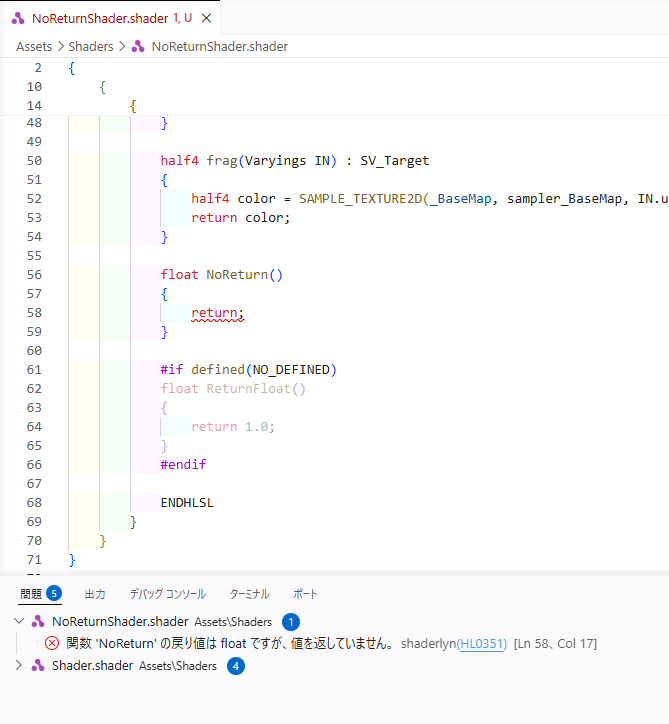
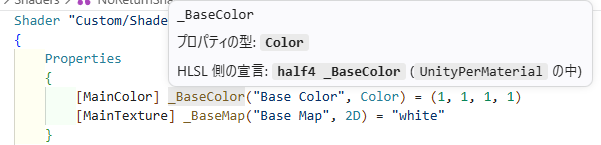
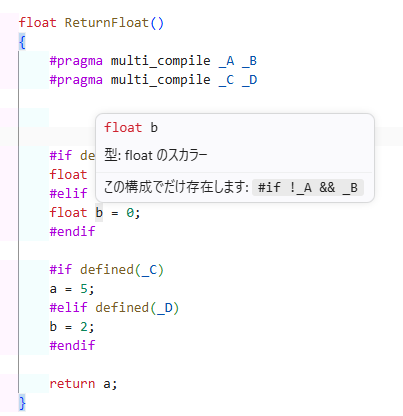
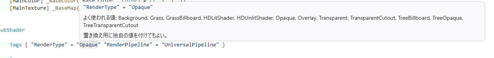
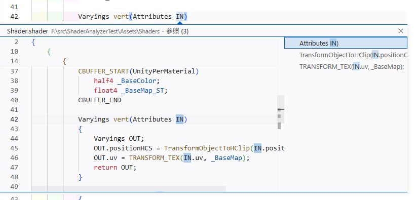
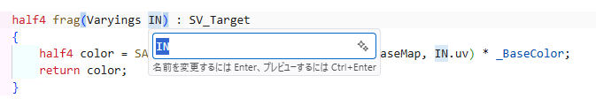
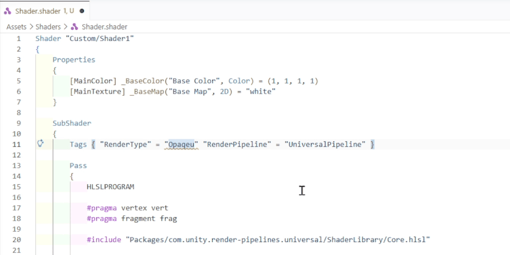
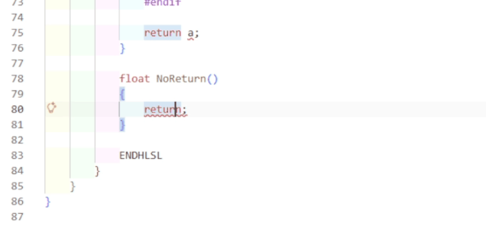
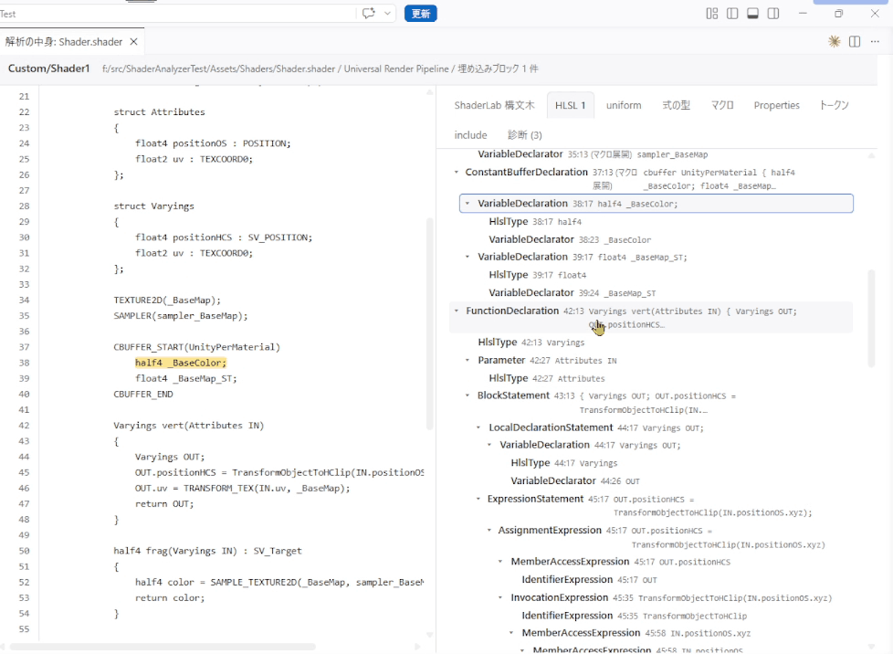
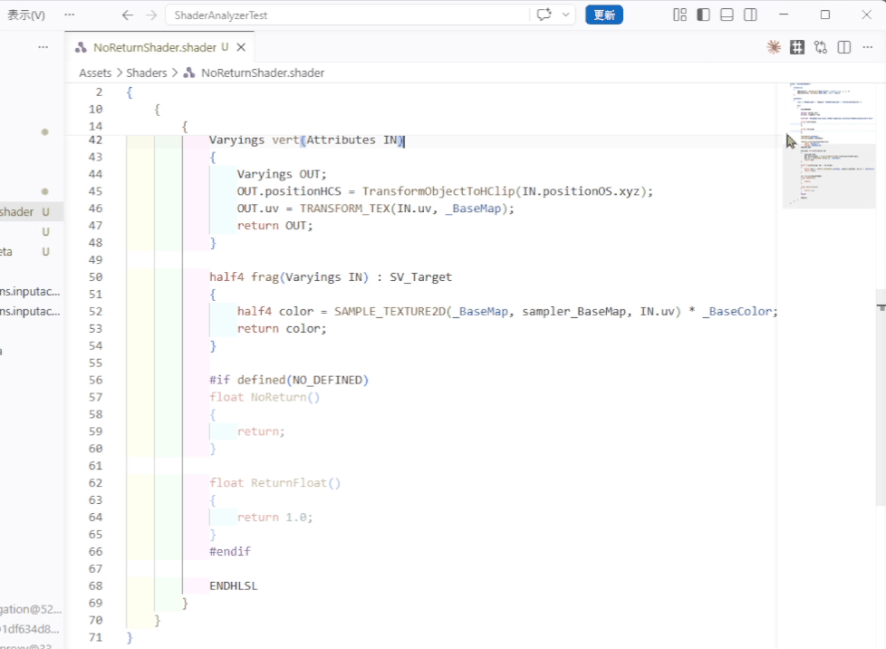

# Shaderlyn for VS Code

[English](README.md) | 日本語

シェーダーの誤りを、編集しながら指摘する VS Code 拡張機能です。
Unity の ShaderLab と HLSL、Unreal Engine、汎用の HLSL、GLSL、Godot、Slang、WGSL を解析し、説明 (ホバー)・補完・定義へ移動も提供します。
GLSL・Godot・Slang・WGSL では、それぞれのコンパイラ (glslang・Godot 4・slangc・naga) と同じ誤りを報告します。

| 言語 | 拡張子 | 設定 |
| --- | --- | --- |
| Unity の ShaderLab と HLSL | `.shader` `.hlsl` `.cginc` `.hlslinc` `.compute` | 不要 (Unity プロジェクトのルートを開く) |
| Unreal Engine | `.usf` `.ush` | 不要 (エンジンとプロジェクトの場所は、開いたファイルから探す) |
| DXC で直接コンパイルする HLSL | `.hlsl` `.hlsli` | `.shaderlyn.yaml` で環境を選ぶ ([環境ごとの使用方法](https://github.com/OmojiP/shaderlyn/blob/main/docs/guide/environments.md)) |
| GLSL | `.vert` `.frag` `.comp` `.geom` `.tesc` `.tese` `.task` `.rgen` `.rint` `.rahit` `.rchit` `.rmiss` `.rcall` `.glsl` | 不要 |
| Godot | `.gdshader` `.gdshaderinc` | 不要 (レンダラーは `project.godot` から読み込む) |
| Slang | `.slang` | 不要 (`import` したモジュールと標準ライブラリを使用する) |
| WGSL | `.wgsl` | 不要 |

同じ解析を [Visual Studio](https://marketplace.visualstudio.com/items?itemName=OmojiP.shaderlyn-visualstudio) と [Rider](https://plugins.jetbrains.com/plugin/36384-shaderlyn) でも使用できます。

## 主な機能

| 機能 | 内容 |
| --- | --- |
| 指摘 | 波線と「問題」パネルに出します。入力のたびに構文・ShaderLab の値などを検査し、開いたときと保存したときに宣言・型・`#include` の解決を要する検査まで行います |
| クイックフィックス | 修正が 1 つに決まる指摘 (スペルミスなど) の修正と、抑制コメント (`// shaderlyn-disable-next-line <ID>`) の挿入 |
| ホバー | 型、マクロの中身、プロパティと HLSL の対応、セマンティクスや `#pragma` の意味 |
| 補完・引数の案内 | 条件付きコンパイルを考慮した候補と、関数の引数 |
| 定義へ移動・参照・名前の変更 | 変数・関数・構造体・マクロと、`Properties` と HLSL の uniform の対応 |
| 無効な範囲の表示 | 条件が外れた `#if` / `#ifdef` の中を薄く表示します。シンボルを選んで、その構成で表示することもできます |
| 解析の中身を見る | 開いているファイルの構文木・トークン・型・マクロ |

### 2 段階の指摘

入力中の動作を重くしないため、編集時と保存時で異なるレベルの解析を行います。

* **入力のたび (即時):** 構文エラー、タグ、Pass 名、レンダーステート、プロパティ名など、そのファイルだけで決まる検査
* **開いたとき・保存したとき:** プロパティと HLSL の整合性 (宣言漏れ・型不一致)、SRP Batcher 適合性など、`#include` の解決を要する検査
* **取り込んだヘッダの指摘:** `.shader` を開いたとき・保存したときに、取り込んでいる共通の `.hlsl` などの指摘も、そのヘッダのファイルに出ます。取り込む側の文脈 (先に宣言した名前やシンボルの構成) で検査した結果です。Unity や外部パッケージのヘッダ (`Library` の下と Unity Editor に同梱のもの) は報告しません
* **無効な範囲の表示:** どの構成でも条件が外れる `#if` / `#ifdef` の中を薄く表示します。`multi_compile` などのシンボルのバリアントで有効になる分岐は薄くしません (シンボルを選んで、その構成で表示することもできます)。`SHADER_API_*` / `SHADER_STAGE_*` / `UNITY_VERSION` などプラットフォームやバージョンで決まる分岐、取り込むヘッダを解決できていない場合、展開の上限で調べきれなかったシンボルの分岐も、判断できないため薄くしません。開いたとき・保存したとき・シンボルを選んだときに更新されます (設定: `shaderlyn.inactiveRegions.enabled` / `.opacity`)



### ホバー

コード上にカーソルを置くと、型や構造体の構成、ShaderLab と HLSL の対応を確認できます。

* **プロパティと HLSL の対応:** `Properties` の項目が HLSL 側でどう宣言されているか (またはどの定数バッファに入っているか)
* **型・式:** 判定された型 (例: `uv.x` → `float`)、マクロの中身、定数バッファの構成や SRP Batcher への影響
* **言語要素:** セマンティクス (`SV_Target` など) の意味、タグやレンダーステートで指定可能な値の一覧
* **`#pragma`:** `vertex` / `multi_compile_fog` / `shader_feature_local_fragment` などの役割と、エントリポイントやシンボルとして書かれた引数の意味







### 定義へ移動・参照・補完

* **定義へ移動 (`F12`):** `Properties` 名と HLSL 側 uniform 名の相互ジャンプ、変数・関数・構造体・マクロの宣言箇所へジャンプ
* **パッケージのパスの解決:** `Packages/com.unity...` などの仮想パスを、実際の `Library/PackageCache` 配下のファイルへ解決してジャンプ
* **補完・引数の案内:** `#ifdef` などの条件付きコンパイルを考慮し、現在の文脈で使用できるメンバーや引数 (シグネチャヘルプ) を提示
  * `#` の後ろでは指令の名前、`#pragma` の後ろでは pragma の名前 (説明付き)、`#pragma vertex` などの後ろではこのファイルの関数、`#if` / `#ifdef` ではシェーダーのシンボルとマクロを出します
  * コメント・文字列の中と、`.shader` の ShaderLab の部分では、HLSL の候補を出しません
* **名前の変更 (`F2`) / 参照の検索 (`Shift+F12`):** スコープを解釈し、対象の名前だけを変更・検索





### クイックフィックス

電球アイコン (`Ctrl+.` / `Cmd+.`) から、1 回の操作で問題を修正できます。

* **値の修正:** スペルミス (`SL1010` など) のように、正しい値が 1 つに決まる場合に修正案を提示
* **警告の抑制:** 該当行にルール ID 付きの抑制コメント (`// shaderlyn-disable-next-line <ID>`) を挿入





### 解析の中身を見る

コマンドパレットから **「Shaderlyn: 解析の中身を見る」** を実行すると、構文木・トークン・式ごとの型判定結果・マクロ一覧を別タブで確認できます。指摘の原因を探すときに使用します。



### HLSL ファイル単体の解析と条件のシンボル

`.hlsl` / `.cginc` / `.hlslinc` / `.compute` を開くと、ファイル全体を 1 つの HLSL として解析します。

`.hlsl` / `.cginc` / `.hlslinc` のような include 前提のファイルは `.shader` から取り込むことが多いため、次の 2 つを報告しません。
`.compute` は 1 ファイルで完結するので報告します。

* シェーダーステージの `#pragma` が存在しない (`UN0301`)
* 宣言されていないシンボルを条件に使用している (`CF0201`)

**条件の中のコードを検査する:**
`#ifdef _FOO` の `_FOO` をファイルのどこでも定義していないと、その分岐の中は解析されません。
エディタ右上のボタン (またはコマンドパレットの **「Shaderlyn: 条件のシンボルを選ぶ」**) で有効にするシンボルにチェックを付けると、`#define _FOO 1` と同じ状態で解析し直します。
`#include` で取り込まれる前提で、`#define` をファイルの中に書いていない場合に使用します。

* 候補は、このファイルの `#if` / `#ifdef` が参照していて、`#define` にも取り込んだヘッダにも定義が存在しない名前です
* 選んだシンボルはファイルごとにワークスペースへ保存され、ウィンドウを再読み込みしても残ります
* チェックをすべて外して確定すると、定義を追加しない状態に戻ります



### シンボルの構成を選んで表示する

`.shader` でも HLSL のファイルでも使用できます。

`#pragma multi_compile` / `#pragma shader_feature` のシンボルで分かれる分岐は、どれかの構成で有効になるので、ふだんは薄くしません。同じボタン (**「Shaderlyn: 条件のシンボルを選ぶ」**) でシンボルにチェックを入れて確定すると、そのシンボルだけを有効にした構成で、無効な分岐を薄く表示します。

* チェックしなかったシンボルは無効として扱います。`multi_compile _ _A _B` で `_A` を選ぶと、`#ifdef _B` の中と `#ifdef _A` の `#else` 側が薄くなります
* 同じ `#pragma` の行に並べたシンボルは、同時には有効になりません。1 つにチェックを付けると、その行の他のチェックが外れます
* `_` を書いていない行 (`multi_compile _A _B`) は、どれか 1 つが必ず有効です。その行を空にはできず、最後の 1 つを外すと戻ります
* シンボルを 1 つも有効にしない構成を見るには、**「すべての構成を合わせて表示」** のチェックを外して確定します。ただし `_` が存在しない行があると、その行には 1 つ入ります
* 元の表示に戻すには、**「すべての構成を合わせて表示」** にチェックを入れ、シンボルのチェックをすべて外して確定します
* 変わるのは薄く表示する範囲だけです。指摘はこれまでどおり、シンボルのバリアントをすべて検査した結果を出します
* プラットフォームで決まる分岐 (`SHADER_API_*` など) と、取り込むヘッダを解決できない構成は、構成を選んでも薄くしません

汎用の HLSL・Unreal の環境では、設定ファイルの `symbols:` で宣言したシンボルが並びます。
値を持つシンボル (`QUALITY: [0, 1, 2]` など) は `QUALITY = 0` / `QUALITY = 1` / `QUALITY = 2` のように並び、値を 1 つ選びます。


---

## インストール

VS Code の拡張機能ビューで **Shaderlyn** を検索してインストールします ([Marketplace](https://marketplace.visualstudio.com/items?itemName=OmojiP.shaderlyn))。
コマンドラインからは `code --install-extension OmojiP.shaderlyn` でインストールできます。
言語サーバーを同梱しているので、.NET のインストールは不要です。

### vsix からインストールする

Marketplace を使用できない環境では、[リリースページ](https://github.com/OmojiP/shaderlyn/releases) から使用する環境の vsix を取得します。

| 環境 | ファイル |
| --- | --- |
| Windows (x64) | `shaderlyn-vscode-win32-x64.vsix` |
| Windows (arm64) | `shaderlyn-vscode-win32-arm64.vsix` |
| macOS (Apple Silicon) | `shaderlyn-vscode-darwin-arm64.vsix` |
| macOS (Intel) | `shaderlyn-vscode-darwin-x64.vsix` |
| Linux (x64) | `shaderlyn-vscode-linux-x64.vsix` |
| Linux (arm64) | `shaderlyn-vscode-linux-arm64.vsix` |

VS Code のコマンドパレットで **「拡張機能: VSIX からのインストール...」** (`Extensions: Install from VSIX...`) を選び、取得したファイルを指定します。
コマンドラインからは次のようにインストールできます。

```bash
code --install-extension shaderlyn-vscode-win32-x64.vsix
```

環境に合わない vsix を選ぶと、VS Code がインストールを断ります。

## 動作条件

* Unity プロジェクトのルート (`Assets` と `ProjectSettings` が存在するフォルダー) を VS Code で開いてください。パッケージの参照などを自動で解決します
* Unreal Engine の `.usf`・`.ush` は、`environment` を書かなくても Unreal Engine の環境で解析します。エンジンとプロジェクトの場所は、開いたファイルから探します (エンジンの中のファイルか、ワークスペースの中の `.uproject`)。見つからない場合は、`.shaderlyn.yaml` に `unreal: engine` / `unreal: project` を書いてください
* Unity 以外の環境 (汎用の HLSL など) では、`.shaderlyn.yaml` に `environment` を書いてください ([環境ごとの使用方法](https://github.com/OmojiP/shaderlyn/blob/main/docs/guide/environments.md))。試すためのテンプレートが [samples/environments](https://github.com/OmojiP/shaderlyn/tree/main/samples/environments) にあります

## 設定

ルールの重要度や無効化は `.shaderlyn.yaml` に書きます ([設定ファイル](https://github.com/OmojiP/shaderlyn/blob/main/docs/guide/configuration.md))。開いたファイルから上へたどって一番近い `.shaderlyn.yaml` を使用し、書き換えると次の解析から反映されます。

拡張機能の設定 (`settings.json`) は次のとおりです。

| 設定項目 | 説明 | 既定値 |
| --- | --- | --- |
| `shaderlyn.serverPath` | 起動する言語サーバーの実行ファイル。空の場合は、同梱したものを使用します。変更したらウィンドウの再読み込みが必要です | `""` |
| `shaderlyn.trace.server` | VS Code と言語サーバーの間の通信を出力パネルに記録する | `"off"` |
| `shaderlyn.inactiveRegions.enabled` | 条件が外れて無効な `#if` / `#ifdef` の中を薄く表示する | `true` |
| `shaderlyn.inactiveRegions.opacity` | 無効な範囲を表示するときの不透明度 (0.1〜1) | `0.45` |

## 自作ルールを使用する

同梱の言語サーバーが実行するのは組み込みルールだけです。自作ルールをエディタでも働かせる場合は、アナライザの一覧を渡すサーバーを自分でビルドし、`shaderlyn.serverPath` に指定します。

サーバーの作り方 (プロジェクト・`Program.cs`・publish) は [自作ルールの作り方「エディタでも働かせる」](../../docs/custom-rules/tutorial.md#5-1-エディタでも働かせる) にあります。ここでは、ビルドしたサーバーを VS Code から使用する手順を説明します。

### 1. VS Code から指す

`settings.json` に、publish した**実行ファイル**の絶対パスを書きます。拡張はこのファイルを引数なしで起動するため、`.dll` は指せません。

```json
{
  "shaderlyn.serverPath": "C:/work/MyShaderRules.Lsp/bin/my-shader-rules-lsp.exe"
}
```

### 2. ウィンドウを再読み込みする

コマンドパレット (`Ctrl+Shift+P` / `Cmd+Shift+P`) から **Developer: Reload Window** を実行します。

**設定を保存しただけでは、サーバーは切り替わりません。** 拡張は `shaderlyn.serverPath` を起動したときに一度だけ読み込みます。再読み込みするまでは前のサーバー (同梱のサーバーなど) が動き続け、エラーも出ないまま自作ルールの指摘だけが出ない状態になります。

次のときは、そのたびに再読み込みしてください。

- `serverPath` を変えたとき
- ルールを追加したり直したりして、サーバーを publish し直したとき

再読み込みしたら `.shader` を開いて保存し、自作ルールの指摘が報告されるかを確認します。HLSL を見るルールは、ファイルを開いたときと保存したときに走ります。打っている最中は ShaderLab 単体の検査だけが走るため、HLSL の指摘はいったん消え、保存すると戻ります。

> **Note**: Windows では、VS Code が動かしているサーバーの実行ファイルは上書きできません。同じフォルダーへ再度 publish すると失敗するため、ウィンドウを閉じてから publish するか、別のフォルダーを指定して `serverPath` を変えてください。

### つまずいたとき

症状ごとの原因と対処は [トラブルシューティング「VS Code 拡張」](../../docs/guide/troubleshooting.md#vs-code-拡張) にまとめてあります。
ルールそのものが指摘を報告しない場合は、同じページの [「自作ルール」](../../docs/guide/troubleshooting.md#自作ルール) を参照してください。

## 他のシェーダー関連の拡張機能との共存

この拡張機能は、`.shader` や `.hlsl` に**独自の言語を登録しません** (構文の色分けを上書きしません)。VS Code 組み込みの `shaderlab` や、他の Unity・シェーダー関連の拡張機能の色分けはそのままで、解析と言語サーバーの機能 (補完・ホバー・定義へ移動など) だけを加えます。

## ドキュメント

[リポジトリ](https://github.com/OmojiP/shaderlyn) を参照してください。

## プライバシー

拡張機能は利用状況の収集 (テレメトリ) を行わず、ネットワークにも接続しません。解析は、拡張機能に同梱したプロセスがローカルで行います。

## ライセンス

MIT License

組み込み関数の表は DirectXShaderCompiler のデータから作っています。その著作権表示とライセンスは、拡張に同梱した THIRD-PARTY-NOTICES.txt にあります。
