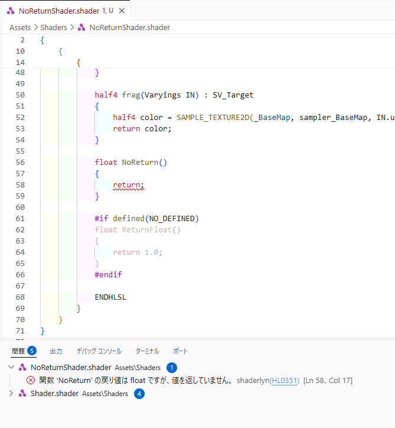
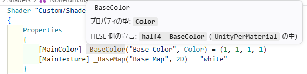
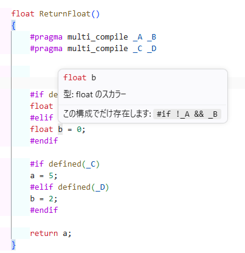
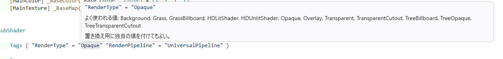
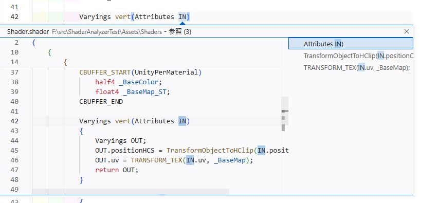
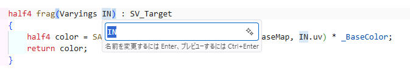
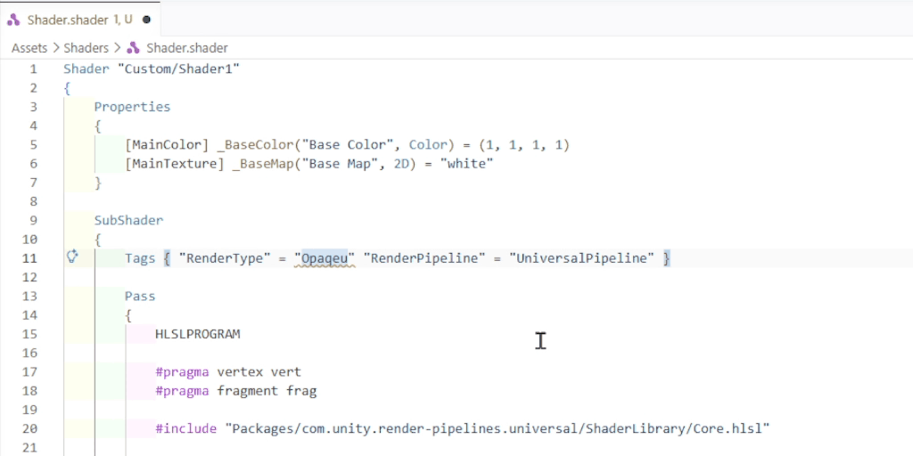
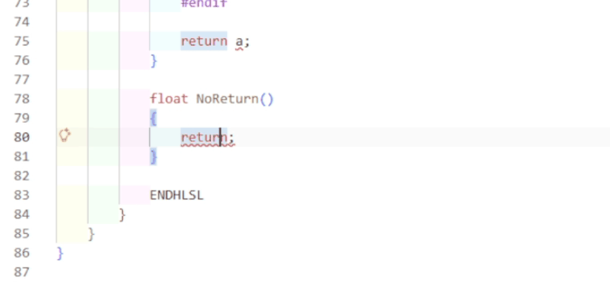
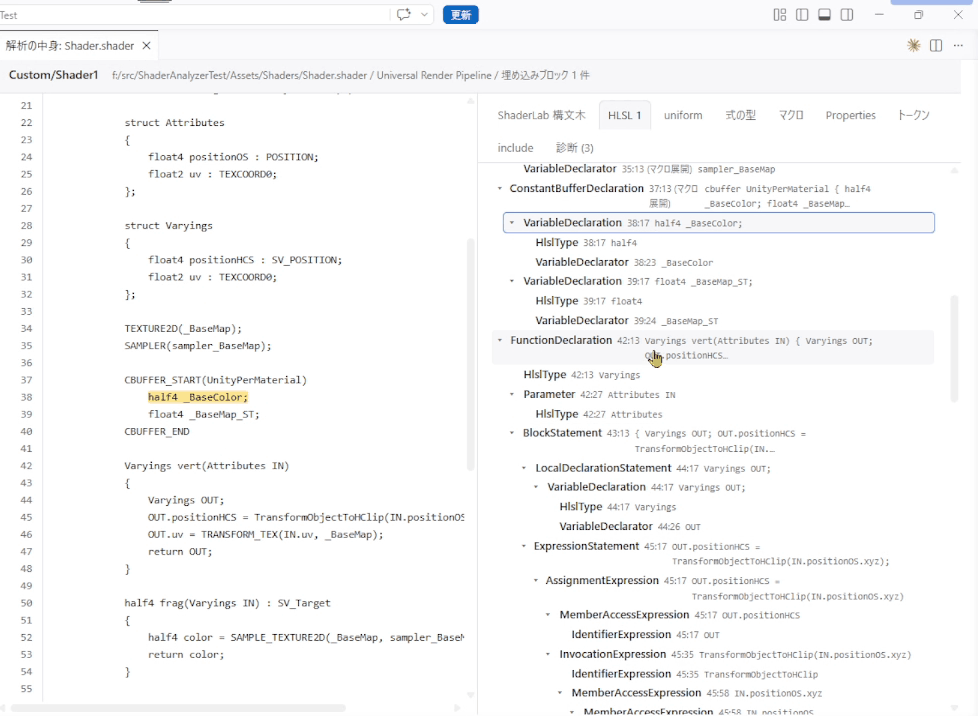
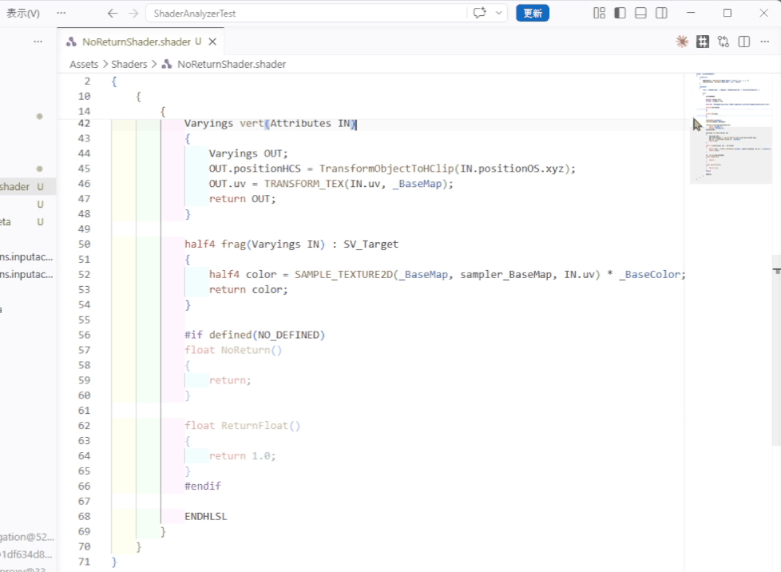

# Shaderlyn for VS Code

English | [日本語](README.ja.md)

Shaderlyn finds errors in shaders as you edit.
It analyzes Unity ShaderLab and HLSL, Unreal Engine, plain HLSL, GLSL, Godot, Slang and WGSL, and also provides hover, completion and navigation.
For GLSL, Godot, Slang and WGSL, it reports the same errors as each language's compiler (glslang, Godot 4, slangc and naga).

| Language | Extensions | Configuration |
| --- | --- | --- |
| Unity ShaderLab and HLSL | `.shader` `.hlsl` `.cginc` `.hlslinc` `.compute` | Not needed (open the Unity project root) |
| Unreal Engine | `.usf` `.ush` | Not needed (the engine and project are found from the opened file) |
| HLSL compiled directly with DXC | `.hlsl` `.hlsli` | Select the environment in `.shaderlyn.yaml` ([environments](https://github.com/OmojiP/shaderlyn/blob/main/docs/guide/environments.md)) |
| GLSL | `.vert` `.frag` `.comp` `.geom` `.tesc` `.tese` `.task` `.rgen` `.rint` `.rahit` `.rchit` `.rmiss` `.rcall` `.glsl` | Not needed |
| Godot | `.gdshader` `.gdshaderinc` | Not needed (the renderer is read from `project.godot`) |
| Slang | `.slang` | Not needed (`import`ed modules and the standard library are used) |
| WGSL | `.wgsl` | Not needed |

The same analysis is available for [Visual Studio](https://marketplace.visualstudio.com/items?itemName=OmojiP.shaderlyn-visualstudio) and [Rider](https://plugins.jetbrains.com/plugin/36384-shaderlyn).

## Features

| Feature | Description |
| --- | --- |
| Diagnostics | Squiggles and the Problems panel. Syntax and ShaderLab values are checked as you type. Declarations, types and `#include` resolution are checked when a file is opened or saved |
| Quick fixes | Fixes for diagnostics with a single correct fix (typos, for example), and insertion of a suppression comment (`// shaderlyn-disable-next-line <ID>`) |
| Hover | Types, macro expansions, the mapping between ShaderLab properties and HLSL, semantics and `#pragma` |
| Completion and signature help | Candidates that take conditional compilation into account, and function parameters |
| Go to definition, references, rename | Variables, functions, structs, macros, and ShaderLab properties mapped to HLSL uniforms |
| Inactive regions | `#if` / `#ifdef` blocks whose condition is false are dimmed. You can also select symbols and view that configuration |
| Inspect the analysis | The syntax tree, tokens, types and macros of the current file |

### Diagnostics in two stages

Analysis is split so that typing stays responsive.

* **As you type:** syntax errors, tags, Pass names, render states, property names and other checks that need only the current file
* **When a file is opened or saved:** consistency between properties and HLSL (missing declarations, type mismatches), SRP Batcher compatibility and other checks that need `#include` resolution
* **Diagnostics in included headers:** when you open or save a `.shader`, diagnostics in the shared `.hlsl` files it includes are shown in those files. They are checked in the context of the including file (names declared before the `#include`, and the symbol configuration). Headers of Unity and external packages (under `Library` and those bundled with the Unity Editor) are not reported
* **Inactive regions:** `#if` / `#ifdef` blocks that are false in every configuration are dimmed. Branches enabled by a variant of `multi_compile` and similar symbols are not dimmed (you can select symbols to view one configuration). Branches decided by the platform or version (`SHADER_API_*`, `SHADER_STAGE_*`, `UNITY_VERSION` and so on), configurations whose headers cannot be resolved, and symbols beyond the expansion limit are not dimmed either, because they cannot be decided. The display is updated when a file is opened or saved, and when symbols are selected (settings: `shaderlyn.inactiveRegions.enabled` / `.opacity`)



### Hover

Hover over code to see types, struct layouts and how ShaderLab maps to HLSL.

* **Properties and HLSL:** how an entry in `Properties` is declared in HLSL (or which constant buffer it is in)
* **Types and expressions:** the inferred type (`uv.x` → `float`, for example), macro expansions, constant buffer layouts and their effect on the SRP Batcher
* **Language elements:** the meaning of semantics (`SV_Target` and so on), and the values allowed for tags and render states
* **`#pragma`:** the role of `vertex`, `multi_compile_fog`, `shader_feature_local_fragment` and so on, and the meaning of the entry points and symbols written as arguments







### Go to definition, references and completion

* **Go to definition (`F12`):** jumps between a `Properties` name and the HLSL uniform, and to the declarations of variables, functions, structs and macros
* **Package paths:** virtual paths such as `Packages/com.unity...` are resolved to the actual files under `Library/PackageCache`
* **Completion and signature help:** members and parameters available in the current context, taking conditional compilation (`#ifdef` and so on) into account
  * After `#`, directive names. After `#pragma`, pragma names (with descriptions). After `#pragma vertex` and similar, the functions in the file. In `#if` / `#ifdef`, shader symbols and macros
  * No HLSL candidates are shown in comments, strings, or the ShaderLab part of a `.shader`
* **Rename (`F2`) and find references (`Shift+F12`):** scopes are resolved, so only the right names are changed





### Quick fixes

Fix a diagnostic in one step from the light bulb (`Ctrl+.` / `Cmd+.`).

* **Value fixes:** when the correct value is unique, such as a typo (`SL1010` and so on)
* **Suppression:** inserts a suppression comment with the rule ID (`// shaderlyn-disable-next-line <ID>`) on the line





### Inspect the analysis

Run **Shaderlyn: 解析の中身を見る** (Inspect the analysis) from the Command Palette to see the syntax tree, tokens, the type of each expression and the macros in a separate tab. This helps find the cause of a diagnostic.



### Analyzing an HLSL file on its own

Opening a `.hlsl`, `.cginc`, `.hlslinc` or `.compute` file analyzes the whole file as one HLSL program.

Files meant to be included (`.hlsl`, `.cginc`, `.hlslinc`) are often used from a `.shader`, so the following are not reported in them.
A `.compute` file is complete on its own, so they are reported there.

* No shader stage `#pragma` (`UN0301`)
* A symbol that is not declared is used in a condition (`CF0201`)

**Checking code inside conditions:**
If `_FOO` in `#ifdef _FOO` is not defined anywhere in the file, the code inside that branch is not analyzed.
Check symbols with the button at the top right of the editor (or **Shaderlyn: 条件のシンボルを選ぶ** (Select condition symbols) from the Command Palette) to analyze the file again as if `#define _FOO 1` were written.
This is useful for files that are included and do not `#define` the symbol themselves.

* The candidates are names that the file's `#if` / `#ifdef` refer to and that are defined neither by `#define` nor in an included header
* The selected symbols are saved per file in the workspace, and remain after the window is reloaded
* Confirming with every check cleared goes back to analyzing without extra definitions



### Viewing one symbol configuration

This works in `.shader` files and HLSL files.

Branches separated by the symbols of `#pragma multi_compile` / `#pragma shader_feature` are enabled in some configuration, so they are normally not dimmed. Check symbols with the same button (**Shaderlyn: 条件のシンボルを選ぶ**) and confirm, and the branches that are inactive in the configuration with only those symbols enabled are dimmed.

* Symbols that are not checked are treated as disabled. Selecting `_A` in `multi_compile _ _A _B` dims the inside of `#ifdef _B` and the `#else` side of `#ifdef _A`
* Symbols on the same `#pragma` line cannot be enabled together. Checking one clears the other checks on that line
* On a line without `_` (`multi_compile _A _B`), one symbol is always enabled. The line cannot be empty, and clearing the last one restores it
* To view the configuration with no symbol enabled, clear **すべての構成を合わせて表示** (Combine all configurations) and confirm. A line without `_` still gets one symbol
* To go back to the original display, check **すべての構成を合わせて表示**, clear every symbol and confirm
* Only the dimmed regions change. Diagnostics are still the result of checking every symbol variant
* Branches decided by the platform (`SHADER_API_*` and so on) and configurations whose headers cannot be resolved are not dimmed even when a configuration is selected

In the plain HLSL and Unreal environments, the symbols declared in `symbols:` of the configuration file are listed.
Symbols with values (`QUALITY: [0, 1, 2]` and so on) are listed as `QUALITY = 0` / `QUALITY = 1` / `QUALITY = 2`, and you select one value.


---

## Installation

Search for **Shaderlyn** in the Extensions view of VS Code and install it ([Marketplace](https://marketplace.visualstudio.com/items?itemName=OmojiP.shaderlyn)).
From the command line, run `code --install-extension OmojiP.shaderlyn`.
The language server is bundled, so .NET does not need to be installed.

### Installing from a vsix

Where the Marketplace is not available, download the vsix for your platform from the [releases page](https://github.com/OmojiP/shaderlyn/releases).

| Platform | File |
| --- | --- |
| Windows (x64) | `shaderlyn-vscode-win32-x64.vsix` |
| Windows (arm64) | `shaderlyn-vscode-win32-arm64.vsix` |
| macOS (Apple Silicon) | `shaderlyn-vscode-darwin-arm64.vsix` |
| macOS (Intel) | `shaderlyn-vscode-darwin-x64.vsix` |
| Linux (x64) | `shaderlyn-vscode-linux-x64.vsix` |
| Linux (arm64) | `shaderlyn-vscode-linux-arm64.vsix` |

Select **Extensions: Install from VSIX...** in the Command Palette and choose the downloaded file.
From the command line:

```bash
code --install-extension shaderlyn-vscode-win32-x64.vsix
```

VS Code refuses a vsix for a different platform.

## Getting started

* For a Unity project, open the project root (the folder that contains `Assets` and `ProjectSettings`) in VS Code. Package references are resolved automatically
* Unreal Engine `.usf` and `.ush` files are analyzed as Unreal Engine without any configuration. The engine and project locations are found from the opened file (a file inside the engine, or a `.uproject` in the workspace). If they are not found, set `unreal: engine` / `unreal: project` in `.shaderlyn.yaml`
* For other environments (plain HLSL and so on), set `environment` in `.shaderlyn.yaml` ([environments](https://github.com/OmojiP/shaderlyn/blob/main/docs/guide/environments.md)). Templates to try are in [samples/environments](https://github.com/OmojiP/shaderlyn/tree/main/samples/environments)

## Settings

Rule severities and disabling rules are configured in `.shaderlyn.yaml` ([configuration](https://github.com/OmojiP/shaderlyn/blob/main/docs/guide/configuration.md)). The nearest `.shaderlyn.yaml` above the opened file is used, and changes take effect from the next analysis.

Extension settings (`settings.json`):

| Setting | Description | Default |
| --- | --- | --- |
| `shaderlyn.serverPath` | The language server executable to start. When empty, the bundled one is used. Reload the window after changing it | `""` |
| `shaderlyn.trace.server` | Records the communication between VS Code and the language server in the Output panel | `"off"` |
| `shaderlyn.inactiveRegions.enabled` | Dims `#if` / `#ifdef` blocks whose condition is false | `true` |
| `shaderlyn.inactiveRegions.opacity` | The opacity of inactive regions (0.1 to 1) | `0.45` |

## Using custom rules

The bundled language server runs only the built-in rules. To see diagnostics from your own rules in the editor, build a language server that includes them and point `shaderlyn.serverPath` to it.

How to build the server (project, `Program.cs`, publish) is described in [writing custom rules, 5-1](https://github.com/OmojiP/shaderlyn/blob/main/docs/custom-rules/tutorial.md#5-1-エディタでも働かせる). This section describes how to use the built server from VS Code.

### 1. Point VS Code to the server

Write the absolute path of the published **executable** in `settings.json`. The extension starts this file without arguments, so a `.dll` cannot be used.

```json
{
  "shaderlyn.serverPath": "C:/work/MyShaderRules.Lsp/bin/my-shader-rules-lsp.exe"
}
```

### 2. Reload the window

Run **Developer: Reload Window** from the Command Palette (`Ctrl+Shift+P` / `Cmd+Shift+P`).

**Saving the setting does not switch the server.** The extension reads `shaderlyn.serverPath` only once, when it starts. Until the window is reloaded, the previous server (the bundled one, for example) keeps running, and your rules report nothing without any error.

Reload the window each time you:

- change `serverPath`
- add or fix rules and publish the server again

After reloading, open and save a `.shader` and check that your rules report diagnostics. Rules that look at HLSL run when a file is opened or saved. While you type, only the ShaderLab checks run, so HLSL diagnostics disappear for a moment and come back when you save.

> **Note**: On Windows, the executable of a server that VS Code is running cannot be overwritten. Publishing again to the same folder fails, so close the window before publishing, or publish to another folder and change `serverPath`.

### Troubleshooting

Causes and fixes for each symptom are in [troubleshooting, VS Code extension](https://github.com/OmojiP/shaderlyn/blob/main/docs/guide/troubleshooting.md#vs-code-拡張).
If a rule itself reports nothing, see [custom rules](https://github.com/OmojiP/shaderlyn/blob/main/docs/guide/troubleshooting.md#自作ルール) on the same page.

## Other shader extensions

This extension **does not register its own languages** for `.shader` or `.hlsl` (it does not override syntax highlighting). The coloring of the built-in `shaderlab` language and other Unity or shader extensions stays as it is, and Shaderlyn adds only analysis and language server features (completion, hover, go to definition and so on).

## Documentation

The documentation is written in Japanese. See the [repository](https://github.com/OmojiP/shaderlyn).

## Privacy

The extension does not collect telemetry and does not connect to the network. Analysis runs in a local process bundled with the extension.

## License

MIT License

The intrinsic function tables are generated from DirectXShaderCompiler data. Its copyright notice and license are in THIRD-PARTY-NOTICES.txt bundled with the extension.
